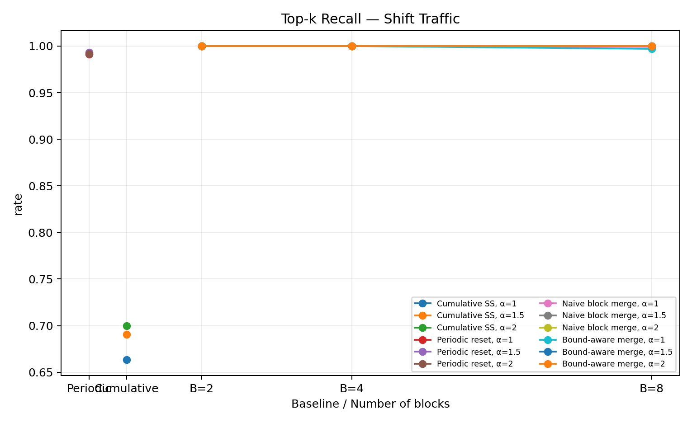
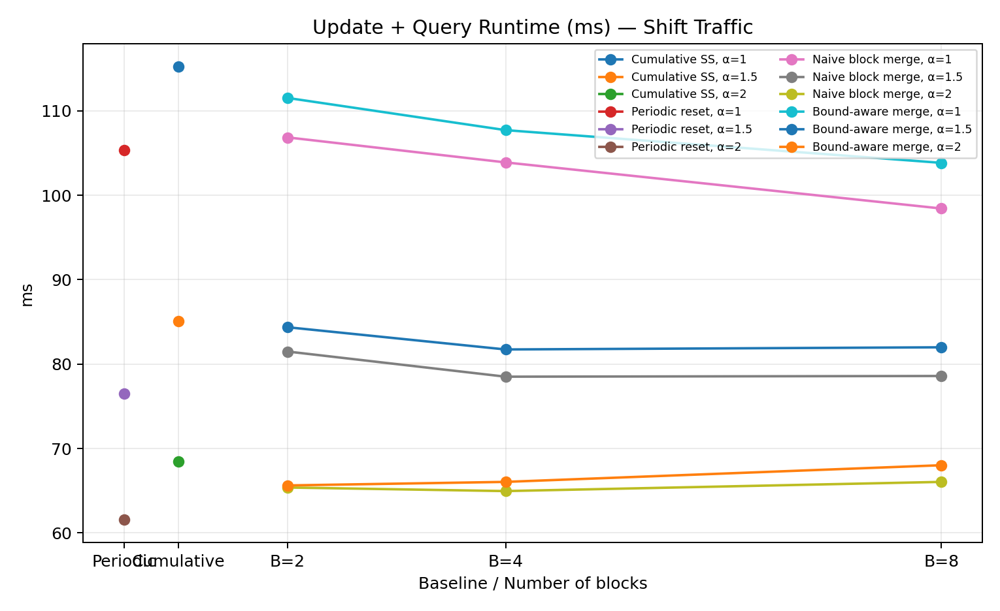
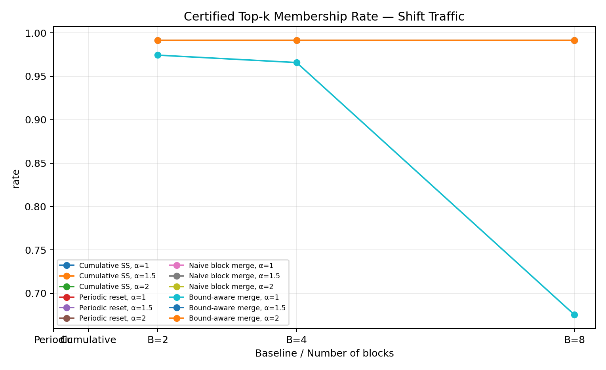

# Sliding Window 實驗結果分析與報告整合

分析日期：2026-11-27。資料基準：`3f816ef` 的 [Periodic 比較 CSV](../results/periodic/windowed_with_periodic.csv)。本次只分析既有量測，沒有重新執行大型實驗或修改演算法。

## 研究問題與證據鏈

本專題在固定計數器預算下，比較保留全部歷史、定期清空與區塊淘汰三種歷史處理方式，觀察近期 Top-k 準確度、結果可認證程度與成本。

1. **文獻依據**：[FSP／FSW 對照](SLIDING_WINDOW_PAPER_COMPARISON_ZH.md)說明分區、資料過期與近期 Top-k 已有研究。本專題是原始 Space-Saving 的區塊式組合與實驗評估，不是完整重現 FSW，也不宣稱首創 Sliding Window。
2. **正確性驗證**：[手算案例](../results/validation/WALKTHROUGH_ZH.md)驗證第 12 筆只代表第 5–12 筆、舊來源淘汰、候選替換與頻率界限。小樣本驗證行為，不能推論一般效能。
3. **實驗觀察**：本頁以新增 Periodic-Reset 的成對實驗分析近期 Top-k 的取捨，並明確限制結論範圍。

## 設定與比較口徑

N=2M、A=10K、W=100K、Top-20、M=1600、B=2/4/8、Q=50K；alpha=1/1.5/2、各三個種子，四種情境 static／shift／gradual／overlap。共 36 組配對 run，每組八個配置，合計 288 筆結果。

- 每次 run 有 39 個查詢點（100K 至 2M，每隔 50K）；其中 20 個位於完整 W 邊界。
- **All-query Tie-aware Recall**：全部查詢，允許第 k 名邊界的有效平手替代答案。
- **Aligned Tie-aware Recall**：只看 t=nW 的 20 個查詢點，Periodic 此時涵蓋完整 W。
- **Certification rate**：嚴格上下界分離的近期 Top-k 集合認證比例。其他方法欄位是 N/A，不能當作 0%。不認證不代表答案錯誤。
- 本頁情境表對三個 alpha、三個種子的 run 平均值等權平均。每個 alpha 的三種子標準差另列於[重算表](../results/periodic/analysis/REPORT_TABLES.md)，不將跨 alpha 差異誤稱為種子變異。
- Static 使用完整 ID 集合，動態情境使用活動半集合；不能把跨情境差異完全歸因於流量變動。

## 核心圖一：流量切換後，哪些方法仍能找到近期熱門來源

**圖的口徑**：這張既有圖使用 `recall`（固定 ID 打破平手），每條線的每個點為三種子平均；不是 Tie-aware Recall，且縱軸沒有從 0 開始。圖中 Periodic／Cumulative 是獨立基準位置，不能把其橫軸位置當成 B 值。線條重疊時應看原始表，不以圖形分辨微小差距。

下表改用原始 CSV 的 Tie-aware 指標，聚焦 shift，跨三個 alpha 與三種子平均：

| 方法 | All-query Tie Recall | Aligned Tie Recall | 查詢取樣偵測覆蓋率 | 已偵測項目平均延遲（封包） |
|---|---:|---:|---:|---:|
| Cumulative | 68.4473% | 68.5556% | 47.2311% | 303,888.9 |
| Periodic-Reset | 99.2165% | 100.0000% | 99.0119% | 1,827.8 |
| Naive B=4 | 100.0000% | 100.0000% | 100.0000% | 0.0 |
| Bound-Aware B=4 | 100.0000% | 100.0000% | 100.0000% | 0.0 |

**觀察**：Cumulative 在此資料中較難適應新熱門來源。由方法機制推論，原因與保留舊歷史有關：它估計的是整段歷史，評分卻針對近期視窗。這是歷史範圍不一致，不表示 Cumulative 對自身累計任務錯誤。

**Periodic 已很準，區塊法仍提供什麼？** 在 150K 時，Periodic 只有 100001–150000 的資料；區塊法涵蓋 50001–150000。Periodic 的全查詢平均涵蓋長度為 W 的 75.6410%，不等於只找對 75.6410% 的 Flow。完整 W 邊界的 Recall 已達 100%，所以不能宣稱它普遍不準；區塊法的優勢在這批資料中是中間合法查詢點仍涵蓋完整近期 W。

延遲是每 50K 查詢取樣的 Top-k 進入延遲，不是逐封包告警。0 表示在首次被觀察到進入真實 Top-k 的查詢點就找到，不代表立即偵測。各方法延遲只對自身已偵測項目計算，來源集合可能不同；這個跨 run 平均不能當作配對因果效果或整體封包級平均延遲。

## 核心圖二：準確度之外，查詢需要付出多少成本

**圖的口徑**：縱軸是完整 run 的更新加查詢總時間，不是單次查詢延遲，且縱軸截短。此圖沒有誤差棒，只供檢視初步量測趨勢。

Shift 跨三個 alpha、三種子平均；每個 run 為 2M 次更新及 39 次查詢：

| 方法 | 更新總時間 ms | 查詢總時間 ms |
|---|---:|---:|
| Cumulative | 86.6843 | 2.9070 |
| Periodic-Reset | 78.9410 | 2.1937 |
| Naive B=4 | 77.4880 | 4.9622 |
| Bound-Aware B=4 | 77.4880 | 7.6744 |

**觀察**：B=4 的兩種合併法在此情境都有 100% Tie Recall，但 Bound-Aware 查詢總時間高約 2.7122 ms，約為 Naive 的 1.55 倍。這只是這份資料中的平均比值，不是已驗證的普遍倍率。兩者共享同一區塊更新路徑，更新時間相同是實驗設計，不是兩份獨立效能量測。

**限制**：每次更新都有計時器成本、執行順序與機器狀態可能影響結果，目前不能據此宣稱某方法顯著更快。每個 alpha 的 n=3 標準差見重算表；正式報告需同一 Linux 主機依序重跑，再畫種子變異。固定計數器不代表固定 bytes；記憶體排除合併暫存、配置器額外成本、輸入與精確基準。

## 核心圖三：答案很準，是否也能證明

**圖的口徑**：只有 Bound-Aware 的近期 W 認證率有效；既有圖例仍列出其他方法，其他方法沒有曲線不是 0%。縱軸截短。

| Shift 方法 | Tie Recall | 集合認證率 |
|---|---:|---:|
| Bound-Aware B=2 | 100.0000% | 98.5755% |
| Bound-Aware B=4 | 100.0000% | 98.2906% |
| Bound-Aware B=8 | 99.9145% | 88.6040% |

**觀察**：B=8 仍有高 Recall，認證率卻明顯較低，說明準確度和可認證程度是不同指標。固定 M 時增加 B，會減少每區塊計數器，可能讓合併區間更寬；這是與機制一致的解釋，不證明 B 越少永遠越好。

**Bound-Aware 是否值得？** 若應用只要求近似排名，Naive 在這批資料可能已足夠；若需要在部分查詢上證明所選集合正確，Bound-Aware 額外成本有明確用途。本結果不建立通用的最佳 B，也不證明 Bound-Aware 在所有預算或流量都比 Naive 準。

## 跨情境核對

| 情境 | Cumulative Tie Recall | Periodic Tie Recall | Naive B=4 Tie Recall | Bound B=4 Tie Recall |
|---|---:|---:|---:|---:|
| static | 98.9459% | 99.2165% | 100.0000% | 100.0000% |
| shift | 68.4473% | 99.2165% | 100.0000% | 100.0000% |
| gradual | 69.5584% | 98.8177% | 99.9858% | 100.0000% |
| overlap | 79.5869% | 99.2165% | 100.0000% | 100.0000% |

Shift 作為主圖是為了清楚解釋流量切換，不代表只有該情境被評估。全部 B 的四情境結果及每個 alpha 的 shift 變異見[重算表](../results/periodic/analysis/REPORT_TABLES.md)。不可混用尚未含 Periodic 的歷史 sensitivity CSV。

## 可放入報告的結論

在本專題的固定 M=1600 合成流量實驗中，區塊式摘要在合法查詢點保留完整近期 W 筆資料，能在動態情境中較好地追蹤近期 Top-k。Periodic-Reset 在完整視窗邊界也表現良好，但中間查詢點只保存部分近期歷史。Naive 與 Bound-Aware 都可能取得高 Recall；Bound-Aware 的額外價值是以頻率界限認證部分結果，而非保證所有情況下更高的準確度。此能力伴隨額外合併查詢成本，最終取捨仍需同環境效能量測與更多工作負載支持。

## 三段口頭報告稿

**文獻與方法**：我們參考 Space-Saving 和 Sliding Window Top-k 文獻，將最近 W 個封包分成 B 個區塊，每區塊維護一份摘要。這不是完整重現 FSW，我們研究的是固定預算下的區塊與合併取捨。

**驗證與準確度**：先用手算案例確認區塊過期與頻率界限，再看大型合成資料。流量切換時，累計法受到歷史範圍影響；Periodic 在完整邊界也很準，區塊法則在中間合法查詢點仍保留完整近期 W。

**可信度與成本**：高 Recall 不等於能證明答案。Bound-Aware 用上下界分離認證結果，但查詢比單純加總更費時。我們將時間數字視為初步結果，正式效能結論還要在共同 Linux 環境重跑。

## 重現與工作範圍

從整合目錄執行 `python3 scripts/summarize_report_results.py` 可由原始 CSV 重建數值表，只使用 Python 標準函式庫。程式檢查 288 筆、36 組完整配置、預設參數及界限違反數，並記錄來源 SHA-256。既有主圖由 `scripts/plot_windowed_results.py` 產生，本次直接引用，未修改圖表或原始量測。

本次新增中文分析、三組圖的判讀、口頭報告稿與重算表。未新增方法、未執行完整 sensitivity／Linux 效能重跑，也不改動團隊既有實驗的貢獻歸屬。
